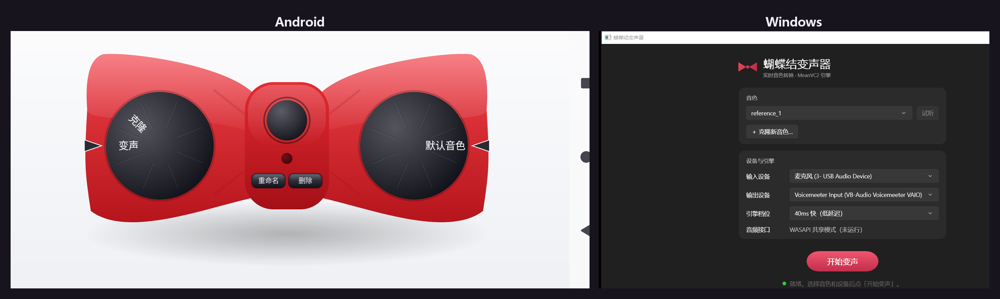

# 蝴蝶结变声器（Bowtie Voice Changer）

> 🎀 转盘一拧，一句话换一个声音。
> 本地实时变声 + 10 秒零样本音色克隆，Android 与 Windows 双端，**全离线运行，音频不出设备**。

灵感来自某名侦探的蝴蝶结变声领结。基于开源语音转换引擎
[MeanVC2](https://github.com/ASLP-lab/MeanVC2)（Apache-2.0），将流式推理运行时移植到
C++（ONNX Runtime），并配上了转盘式的三端交互。

<p align="center">
  
</p>

## ✨ 功能

- **实时变声**：40ms 音频块流式推理，边说边变；另有 160ms 高质量档可选（Windows 端热切换）
- **零样本音色克隆**：10 秒参考音频，现场录音或导入文件均可，即刻拥有新音色
- **转盘交互**：左转盘切换 变声/克隆 模式，右转盘旋转选择音色卡（Android）
- **双引擎档位**：40ms 低延迟 / 160ms 高质量，预缓冲、增益、接缝淡入淡出均可调
- **全离线**：引擎与模型全部在本机运行，不依赖任何云服务

## 📱 Android

最低 Android 8（arm64-v8a）。界面即一只红色蝴蝶结：左翼转盘选模式，右翼转盘选音色，
中央按钮开始/停止变声，克隆模式录满 10 秒自动截取最响亮片段。

## 🖥 Windows

WinUI 3 单窗口（Mica 质感），WASAPI 共享模式采集，支持虚拟声卡输出
（Voicemeeter / VB-Cable，接 Discord、腾讯会议等把变声后的声音当麦克风）。

实测基线（GTX 1650 级别的机器）：40ms 块稳态端到端发射延迟 ~174ms，
单块计算 ~20ms，流式 RTF < 0.55。

## 🔨 从源码构建

### 公共依赖

1. 克隆上游引擎仓库，**与本仓库同级放置**（构建脚本按相对路径取模型）：

```bash
git clone https://github.com/ASLP-lab/MeanVC2.git
git clone https://github.com/<you>/bowtie-voice-changer.git
```

2. 按 MeanVC2 README 获取 checkpoint，并用其导出脚本得到 ONNX 模型，放入
   `MeanVC2/onnx_models/`，需要以下文件：

```
kaldi_fbank.onnx  asr_80ms_fp32.onnx  dit_40ms_fp32.onnx  dit_120ms_fp32.onnx(可选)
vocos_fp32.onnx  vocos_istft_t6.onnx  vocos_istft_t14.onnx(可选)
resample_48k16k.onnx  resample_16k48k.onnx  spk_encoder_fp32.onnx  spk_encoder_q4.onnx(+.data)
```

（我们也在 Releases 提供打好包的模型压缩包，解压到 `MeanVC2/onnx_models/` 即可。）

### Android

- Android Studio（AGP 8.7）/ JDK 17 / NDK
- 模型会由 `syncMeanvcAssets` 任务从 `../../MeanVC2/onnx_models` 自动同步进 APK

```bash
cd meanvc-android
gradle assembleDebug        # 产物: app/build/outputs/apk/debug/app-debug.apk
```

### Windows

- 便携 zig 0.13（引擎编译）+ .NET 8 SDK（UI）+ onnxruntime 1.22（`MeanVC2/runtime_cpp/` 内已有）

```bash
cd win/engine && build.cmd            # 产出 mvc_engine.dll
cd ../app    && dotnet build -c Release
# 运行 win/app/bin/Release/net8.0-windows10.0.19041.0/win-x64/BowtieVC.exe
```

开发模式（源码树内运行）会自动回退使用 `../../MeanVC2` 的模型与默认音色卡。

## 📁 目录结构

```
meanvc-android/   Android App（Kotlin + JNI 壳，无 AndroidX 依赖）
win/              Windows App（C ABI 引擎 DLL + WinUI3 + 冒烟/对拍/安装器）
MeanVC2/          上游引擎仓库（自行克隆，不入本仓库）
assets-src/       UI 素材源
tools/            一次性工具脚本
NOTICE.md         开源归属声明（见 meanvc-android/NOTICE.md）
```

## ⚖️ 许可与声明

- 本项目代码以 [Apache-2.0](LICENSE) 开源。
- 引擎 [MeanVC2](https://github.com/ASLP-lab/MeanVC2) 同为 Apache-2.0，
  按 Apache-2.0 再分发，保留 [NOTICE](meanvc-android/NOTICE.md) 与上游版权声明；
  模型致谢 F5-TTS 等上游项目，详见 NOTICE。
- ⚠️ **克隆他人音色前请取得对方同意**。禁止将本项目用于冒充、诈骗等违法用途，后果自负。

## 🙏 致谢

- [ASLP-lab/MeanVC2](https://github.com/ASLP-lab/MeanVC2) — 引擎与模型
- [F5-TTS](https://github.com/SWivid/F5-TTS) — DiT-CFM 骨干
- [WeNet](https://github.com/wenet-e2e/wenet) / kaldi — 流式 ASR 前端
- [onnxruntime](https://github.com/microsoft/onnxruntime) — 推理运行时
